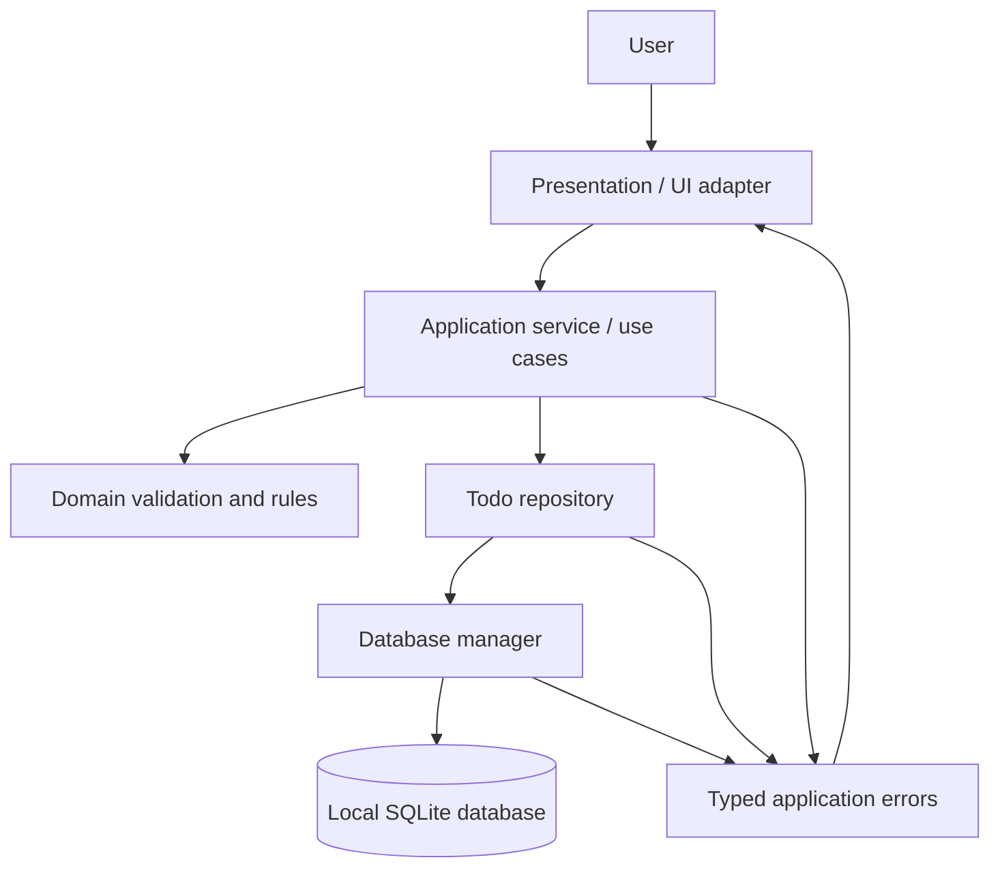
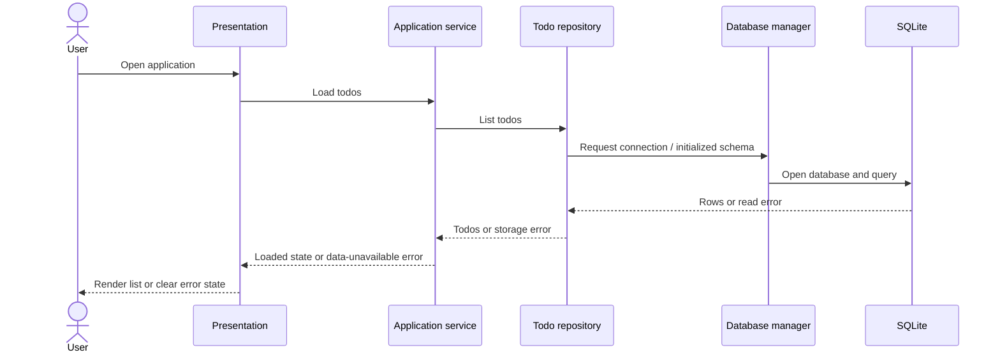

# Todo App — High-Level System Architecture

## 1. Purpose and scope

This document proposes a high-level architecture for the todo application described in [`requirements.md`](requirements.md). The MVP is a local, single-user application backed by SQLite. Users can create, edit, complete, delete, search, and filter todos. Successfully saved data must survive application restarts, while failed operations must leave the last successfully persisted state intact.

The repository is Python-based and already has database, repository, and service modules. This proposal builds on those modules and does not prescribe a new UI framework because the requirements and current repository structure do not establish one.

## 2. Architectural approach

Use a small, layered, local-first architecture:

- **Presentation layer** handles input, rendering, confirmation, and user-facing errors.
- **Application/service layer** implements use cases, validation, and error translation.
- **Repository layer** provides todo-focused persistence operations and search/filter queries.
- **Database layer** manages SQLite connections, schema initialization, transactions, and migrations.
- **SQLite** is the durable source of truth.

The UI is an adapter over the application service. It must not issue SQL or implement persistence rules itself. A web server, remote service, and remote database are unnecessary for the single-user local MVP.

## 3. Component diagram



## 4. Components and responsibilities

### 4.1 Presentation / UI adapter

**Responsibilities**
- Capture create, edit, toggle, delete, search, and filter actions.
- Ask for confirmation before permanent deletion.
- Display todos, search results, status filters, and the “No results” state.
- Display inline validation feedback and user-readable storage/load errors.
- Reflect a mutation only after successful persistence, or restore the last saved state after failure.
- Show a distinct data-unavailable state if startup loading fails; do not make a failed load look like a successful empty list.

**Constraints**
- Do not contain SQL or directly mutate the database.
- Identify todos by stable ID, never by list position.
- Search and filter interactions must not invoke mutation operations.

**Technology**
- Keep the existing UI/CLI if one exists and is suitable. The UI framework is an implementation decision; requirements do not mandate one. Any future UI should call the same application service.

### 4.2 Application service / use-case layer

**Responsibilities**
- Expose operations such as `create_todo`, `edit_todo`, `set_completed`, `delete_todo`, `list_todos`, and `search_todos`.
- Normalize titles by trimming leading and trailing whitespace.
- Validate that titles are non-empty after trimming and no longer than 255 characters.
- Validate status-filter input and translate the UI's Active/Completed choices into the domain representation.
- Coordinate repository calls and return the persisted state after successful writes.
- Translate validation, not-found, and persistence exceptions into predictable application errors that the UI can present safely.
- Ensure quick sequential updates pass through one service/repository path and do not apply stale UI state as authoritative.

**Technology**
- Python service layer, extending or adapting the existing `src/service.py`.

### 4.3 Todo repository

**Responsibilities**
- Encapsulate SQL and map database rows to/from todo domain objects.
- Implement create, get/list, update title, update completion, and delete operations by stable ID.
- Implement optional title search and status filtering, combining active criteria with AND semantics.
- Use parameterized query values. Any SQL identifiers that cannot be parameterized must come from a fixed allowlist.
- Execute mutations atomically where appropriate and return the persisted record/result.
- Convert SQLite failures into repository/storage errors without exposing raw SQL to the UI.

**Technology**
- Python `sqlite3`, extending or adapting the existing `src/repository.py`.

### 4.4 Database manager

**Responsibilities**
- Resolve the configured local database path and open/close connections safely.
- Initialize the database schema on application startup when needed.
- Set appropriate SQLite connection options and constraints.
- Provide transaction boundaries or connection/session management for repository operations.
- Report initialization, read, and write failures to the repository/service layers.
- Provide a migration path before incompatible schema changes are introduced.

**Technology**
- Python standard-library `sqlite3`, extending or adapting the existing `src/database.py`.

### 4.5 SQLite database

**Responsibilities**
- Act as the durable source of truth for todo records.
- Enforce primary key and appropriate basic data constraints.
- Preserve todos across process restart/reload.

**Suggested logical schema**

```sql
CREATE TABLE todos (
    id INTEGER PRIMARY KEY AUTOINCREMENT,
    title TEXT NOT NULL CHECK (length(trim(title)) BETWEEN 1 AND 255),
    completed INTEGER NOT NULL DEFAULT 0 CHECK (completed IN (0, 1)),
    created_at TEXT NOT NULL,
    updated_at TEXT NOT NULL
);
```

The schema is illustrative. If the existing `tasks` table contains data, do not replace or rename it without a migration plan and a decision about mapping old fields.

### 4.6 Error model

Use distinct internal error categories, for example:

- `ValidationError`: invalid title or filter input.
- `NotFoundError`: requested todo ID does not exist.
- `StorageError`: database initialization, read, or write failure.

The UI should show concise, actionable messages. Raw SQL, database paths, and implementation details should be retained only in diagnostic logging where appropriate, not exposed to the user.

### 4.7 Test suite

**Responsibilities**
- Verify title validation and normalization.
- Verify repository persistence, IDs, timestamps, parameterized search/filter behavior, and transactions.
- Verify service behavior for success, not-found, and failure cases.
- Verify UI-facing flows for loading errors, mutation errors, confirmation, and no-results states.

**Technology**
- pytest, consistent with the existing test setup. Use temporary SQLite databases in tests to isolate data and avoid changing a developer's local database.

## 5. Data model and compatibility decision

The requirements define each todo with `id`, `title`, `completed`, `created_at`, and `updated_at`. The repository currently has a broader task model with a `status` field (`pending`/`done`) and fields such as description, priority, and due date.

Before implementation, choose one of these approaches:

1. **Keep the existing schema:** Map `pending` to `completed = false` and `done` to `completed = true` at the service/domain boundary. Preserve additional columns if existing users or features need them.
2. **Adopt the requirements schema:** Add a schema migration mapping `pending` to `0` and `done` to `1`, preserving IDs and timestamps and deciding what to do with additional columns.

Do not store both `status` and `completed` without a single authoritative representation and explicit synchronization rules. Because the current database may contain data, schema changes must be backward-safe or migrated.

## 6. Data flows

### 6.1 Startup and todo loading



A load error is not equivalent to an empty result. The application must keep those states distinct.

### 6.2 Create, edit, toggle, and delete

```mermaid
sequenceDiagram
    actor User
    participant UI as Presentation
    participant App as Application service
    participant Repo as Todo repository
    participant SQLite

    User->>UI: Submit action for todo / title
    UI->>App: Action with stable ID and input
    App->>App: Normalize and validate input
    alt Validation fails
        App-->>UI: Validation error
        UI-->>User: Show inline message; do not write
    else Valid action
        App->>Repo: Execute mutation by ID
        Repo->>SQLite: Parameterized SQL in transaction
        alt Persistence succeeds
            SQLite-->>Repo: Commit result / persisted row
            Repo-->>App: Persisted state
            App-->>UI: Success with authoritative state
            UI-->>User: Render persisted state
        else Persistence fails
            SQLite-->>Repo: Database error / rollback
            Repo-->>App: Storage error
            App-->>UI: Operation failed
            UI-->>User: Show error; preserve last saved state
        end
    end
```

For permanent deletion, the UI obtains confirmation before calling the service. A successful delete removes that ID; a failed delete leaves the item visible and reports failure.

### 6.3 Search and filtering

1. The UI passes the query and selected status to the list/search use case.
2. The service validates supported filter values.
3. The repository applies case-insensitive title matching and the optional status condition, combining conditions with AND.
4. The UI renders matching records, an explicit “No results” state, or an error state.
5. No write operation is performed.

For a few thousand local records, querying SQLite is the recommended initial implementation. Measure performance with representative data before adding full-text search or more complex indexing. Substring searches may not benefit from a conventional B-tree index; consider SQLite FTS only if profiling shows it is needed and its matching semantics meet the product requirements.

## 7. Reliability and consistency rules

- **Persist before acknowledging success:** the UI must not present an uncommitted mutation as saved.
- **Return persisted state:** successful mutation use cases return the stored row/state so the UI can render the authoritative result.
- **Use transactions:** writes should be atomic; on failure, roll back and leave the last committed state intact.
- **Serialize mutation handling:** route writes through the service/repository path. Rapid operations should not reapply stale snapshots over newer persisted values.
- **Catch storage errors:** database lock, unavailable file, schema initialization, and read/write errors must be handled without crashing the app.
- **Distinguish empty from unavailable:** only a successful query returning zero rows is an empty list.
- **Parameterized values:** search text and all other user-controlled values must be bound parameters.
- **Startup initialization:** initialize/check the schema before serving list operations, and surface initialization failure.
- **Performance target:** verify loading a few thousand records in the target runtime; avoid prematurely introducing remote services or caching.

## 8. Technology summary

| Concern | MVP choice | Rationale |
|---|---|---|
| Language | Python | Matches the existing repository. |
| Database | SQLite via Python `sqlite3` | Local durable persistence with no separate server for a single-user app. |
| Application structure | Layered service/repository/database modules | Matches current code and separates UI, business rules, and persistence. |
| UI | Existing interface, or a replaceable adapter | No UI framework is mandated by the requirements or repository overview. |
| Tests | pytest with temporary SQLite databases | Existing test suite uses pytest; isolates tests and supports persistence/error testing. |
| Schema evolution | Explicit SQL migrations when needed | Protects existing data when reconciling the task schema with the todo requirements. |

## 9. Repository mapping

- `src/database.py` — database configuration, connection lifecycle, initialization, and migrations.
- `src/repository.py` — todo SQL, mapping, search/filter, and transactional writes.
- `src/service.py` — use cases, title validation/normalization, and application error translation.
- Presentation module — calls the service and renders UI/CLI state; framework choice remains open.
- `tests/` — unit and integration coverage using isolated databases.

## 10. Key decisions to confirm during implementation

1. Whether to retain the current `tasks` schema and map `pending`/`done`, or migrate to the requirements' `completed` field.
2. Which current UI/entry point will act as the presentation layer; requirements do not specify a UI framework.
3. Whether a future schema migration must preserve the existing description, priority, and due-date fields.
4. Whether timestamps are generated in the application or by SQLite. Whichever is chosen, use one consistent UTC representation and preserve `created_at` on updates.
