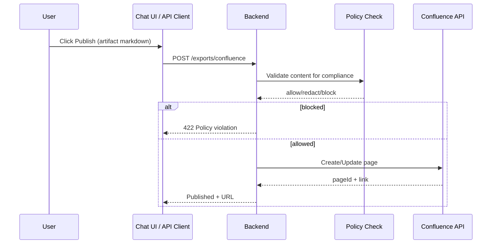

## Todo App — Design and Wireframes
### 1) Goals
- Build a **Design Assistant** that generates **per-artifact** deliverables:
  - Architecture document/diagram
  - HLD
  - LLD
  - Wireframes
- Support **both Chat UI and API** usage.
- Support **export to Confluence** (target space provided).

<<<<<<< HEAD
### Users
- PM, Engineering (dev/architect), UX, QA, Stakeholders.

### Key constraints
- **No saving/versioning** of generated artifacts (stateless or minimal ephemeral session context).
- **Security/compliance required** (details TBD).
- **Per-artifact generation** (user chooses artifact type each time).

### Success criteria
- User can generate any artifact in a consistent template with:
  - assumptions + open questions
  - NFRs and risks
  - Mermaid diagrams where applicable
- One-click / API-triggered **publish to Confluence** under the provided space.

---

## 2) Assumptions & open questions
### Assumptions
- “No saving/versioning” means:
  - No long-term storage of artifacts in our DB.
  - We may keep **temporary session context** during a chat/API call to maintain continuity.
- Confluence export uses Atlassian REST APIs with user/service authentication.
- Security/compliance means we must implement: authentication, authorization, audit logging, data minimization, and safe handling of sensitive content.

### Open questions (need your answers to finalize LLD)
1. **Auth model**: SSO (SAML/OIDC), Atlassian OAuth, API keys, or internal auth? Who are the users?
2. **Data handling**: Are prompts/designs allowed to contain **customer PII/secrets**? Any redaction requirements?
3. **Audit**: Do you require audit logs for: prompt, artifact generated, and Confluence publish action?
4. **Confluence specifics**:
   - Should we publish into a **specific parent page** in that space?
   - Naming convention for pages? (e.g., `{Project} - HLD`)
5. **Diagram rendering**: Should Mermaid remain as code blocks, or do you want Confluence-friendly macros/markup conversion?

I’ll proceed with reasonable defaults in the design below and mark where these answers plug in.

---

# 3) Architecture (review-ready)

## 3.1 System context
**System:** Design Assistant (Chat + API)  
**Outputs:** Markdown (and Mermaid) artifacts; publish to Confluence pages.

**External systems:**
- Confluence Cloud (Atlassian)
- Enterprise Identity Provider (assumed, due to compliance) — exact mechanism TBD

## 3.2 Component breakdown
1. **Chat UI**
   - Artifact picker (Architecture/HLD/LLD/Wireframes)
   - Prompt intake + clarifications
   - Preview + “Publish to Confluence”

2. **Public API**
   - Endpoints to generate each artifact
   - Endpoint to publish artifact to Confluence

3. **Backend Orchestrator**
   - Applies templates per artifact
   - Manages clarification loop
   - Enforces policy checks (security/compliance)

4. **Template/Rules Engine**
   - Standard sections per artifact
   - Validation rules (must include assumptions/open questions/checklist)

5. **Confluence Publisher**
   - Creates/updates Confluence pages
   - Handles formatting conversion (Markdown → Confluence storage format/HTML as needed)

6. **Security & Compliance Layer**
   - Authentication + authorization
   - Content policy checks (e.g., detect secrets, blocklist)
   - Audit logging (configurable; details in open questions)

7. **Ephemeral Context Store (optional but recommended)**
   - Short-lived session context for a single conversation or request chain
   - TTL-based; **not** versioning

## 3.3 Architecture diagram (Mermaid)
```mermaid
flowchart LR
  U[User] --> UI[Chat UI]
  U --> API[Public API Client]

  UI --> GW[API Gateway / Backend API]
  API --> GW

  GW --> AUTH[AuthN/AuthZ]
  GW --> ORCH[Design Orchestrator]
  ORCH --> TPL[Template & Validation Engine]
  ORCH --> POL[Security/Compliance Policy Checks]
  ORCH --> CTX[Ephemeral Session Context (TTL)]

  ORCH --> OUT[Artifact Output: Markdown + Mermaid]
  UI <-- OUT
  API <-- OUT

  GW --> PUB[Confluence Publisher]
  PUB --> CONF[Atlassian Confluence Cloud]
  PUB --> AUD[Audit Log Sink]
```

## 3.4 Key data flows
### Flow A — Generate artifact (Chat or API)
1. User selects artifact type + provides inputs.
2. Orchestrator extracts brief; if missing critical info → returns clarifying questions.
3. User answers → generation proceeds.
4. Validation ensures required sections exist; returns markdown + diagrams.

### Flow B — Publish to Confluence
1. User clicks “Publish” (or API call).
2. Publisher authenticates with Confluence.
3. Create or update page under configured Space/Parent.
4. Return Confluence page URL.

## 3.5 Security & compliance (architecture-level controls)
- **AuthN/AuthZ**: enforce user identity and permissions for generation + publishing.
- **Tenant/space controls**: publishing restricted to allowed Confluence space(s).
- **Content controls**:
  - redact/block secrets (tokens, passwords) if present
  - prevent publishing if policy violations detected
- **Audit events** (recommended even without versioning):
  - user initiated generation
  - user initiated publish
  - target Confluence page/space
  - policy action taken (allowed/redacted/blocked)

---

# 4) High-Level Design (HLD)

## 4.1 Major features (per-artifact workflow)
- Artifact selection: Architecture / HLD / LLD / Wireframes
- Input form + free-text prompt
- Clarifying questions panel
- Preview output
- Publish to Confluence

## 4.2 Artifact generators (responsibilities)
- **Architecture generator**
  - context, boundaries, components, flows, NFRs
  - Mermaid diagram(s)
- **HLD generator**
  - modules, responsibilities, interactions, risks
- **LLD generator**
  - APIs, schemas, sequences, error handling, edge cases
- **Wireframe generator**
  - screen-by-screen, states, accessibility

## 4.3 Confluence export (HLD behavior)
- Map each artifact to:
  - page title
  - labels (optional)
  - content body (converted from Markdown)
- Publish modes:
  - Create new page
  - Update existing page (by pageId or title lookup)

## 4.4 Risks
- Confluence formatting incompatibilities (Mermaid/macros) → decide rendering approach.
- Compliance ambiguity → finalize policy rules early.
- No persistence can reduce UX continuity → mitigate with ephemeral context and “export inputs” option.

---

=======
## 1) Scope
### Goals
- Build a **Design Assistant** that generates **per-artifact** deliverables:
  - Architecture document/diagram
  - HLD
  - LLD
  - Wireframes
- Support **both Chat UI and API** usage.
- Support **export to Confluence** (target space provided).

### Users
- PM, Engineering (dev/architect), UX, QA, Stakeholders.

### Key constraints
- **No saving/versioning** of generated artifacts (stateless or minimal ephemeral session context).
- **Security/compliance required** (details TBD).
- **Per-artifact generation** (user chooses artifact type each time).

### Success criteria
- User can generate any artifact in a consistent template with:
  - assumptions + open questions
  - NFRs and risks
  - Mermaid diagrams where applicable
- One-click / API-triggered **publish to Confluence** under the provided space.

---

## 2) Assumptions & open questions
### Assumptions
- “No saving/versioning” means:
  - No long-term storage of artifacts in our DB.
  - We may keep **temporary session context** during a chat/API call to maintain continuity.
- Confluence export uses Atlassian REST APIs with user/service authentication.
- Security/compliance means we must implement: authentication, authorization, audit logging, data minimization, and safe handling of sensitive content.

### Open questions (need your answers to finalize LLD)
1. **Auth model**: SSO (SAML/OIDC), Atlassian OAuth, API keys, or internal auth? Who are the users?
2. **Data handling**: Are prompts/designs allowed to contain **customer PII/secrets**? Any redaction requirements?
3. **Audit**: Do you require audit logs for: prompt, artifact generated, and Confluence publish action?
4. **Confluence specifics**:
   - Should we publish into a **specific parent page** in that space?
   - Naming convention for pages? (e.g., `{Project} - HLD`)
5. **Diagram rendering**: Should Mermaid remain as code blocks, or do you want Confluence-friendly macros/markup conversion?

I’ll proceed with reasonable defaults in the design below and mark where these answers plug in.

---

# 3) Architecture (review-ready)

## 3.1 System context
**System:** Design Assistant (Chat + API)  
**Outputs:** Markdown (and Mermaid) artifacts; publish to Confluence pages.

**External systems:**
- Confluence Cloud (Atlassian)
- Enterprise Identity Provider (assumed, due to compliance) — exact mechanism TBD

## 3.2 Component breakdown
1. **Chat UI**
   - Artifact picker (Architecture/HLD/LLD/Wireframes)
   - Prompt intake + clarifications
   - Preview + “Publish to Confluence”

2. **Public API**
   - Endpoints to generate each artifact
   - Endpoint to publish artifact to Confluence

3. **Backend Orchestrator**
   - Applies templates per artifact
   - Manages clarification loop
   - Enforces policy checks (security/compliance)

4. **Template/Rules Engine**
   - Standard sections per artifact
   - Validation rules (must include assumptions/open questions/checklist)

5. **Confluence Publisher**
   - Creates/updates Confluence pages
   - Handles formatting conversion (Markdown → Confluence storage format/HTML as needed)

6. **Security & Compliance Layer**
   - Authentication + authorization
   - Content policy checks (e.g., detect secrets, blocklist)
   - Audit logging (configurable; details in open questions)

7. **Ephemeral Context Store (optional but recommended)**
   - Short-lived session context for a single conversation or request chain
   - TTL-based; **not** versioning

## 3.3 Architecture diagram (Mermaid)
```mermaid
flowchart LR
  U[User] --> UI[Chat UI]
  U --> API[Public API Client]

  UI --> GW[API Gateway / Backend API]
  API --> GW

  GW --> AUTH[AuthN/AuthZ]
  GW --> ORCH[Design Orchestrator]
  ORCH --> TPL[Template & Validation Engine]
  ORCH --> POL[Security/Compliance Policy Checks]
  ORCH --> CTX[Ephemeral Session Context (TTL)]

  ORCH --> OUT[Artifact Output: Markdown + Mermaid]
  UI <-- OUT
  API <-- OUT

  GW --> PUB[Confluence Publisher]
  PUB --> CONF[Atlassian Confluence Cloud]
  PUB --> AUD[Audit Log Sink]
```

## 3.4 Key data flows
### Flow A — Generate artifact (Chat or API)
1. User selects artifact type + provides inputs.
2. Orchestrator extracts brief; if missing critical info → returns clarifying questions.
3. User answers → generation proceeds.
4. Validation ensures required sections exist; returns markdown + diagrams.

### Flow B — Publish to Confluence
1. User clicks “Publish” (or API call).
2. Publisher authenticates with Confluence.
3. Create or update page under configured Space/Parent.
4. Return Confluence page URL.

## 3.5 Security & compliance (architecture-level controls)
- **AuthN/AuthZ**: enforce user identity and permissions for generation + publishing.
- **Tenant/space controls**: publishing restricted to allowed Confluence space(s).
- **Content controls**:
  - redact/block secrets (tokens, passwords) if present
  - prevent publishing if policy violations detected
- **Audit events** (recommended even without versioning):
  - user initiated generation
  - user initiated publish
  - target Confluence page/space
  - policy action taken (allowed/redacted/blocked)

---

# 4) High-Level Design (HLD)

## 4.1 Major features (per-artifact workflow)
- Artifact selection: Architecture / HLD / LLD / Wireframes
- Input form + free-text prompt
- Clarifying questions panel
- Preview output
- Publish to Confluence

## 4.2 Artifact generators (responsibilities)
- **Architecture generator**
  - context, boundaries, components, flows, NFRs
  - Mermaid diagram(s)
- **HLD generator**
  - modules, responsibilities, interactions, risks
- **LLD generator**
  - APIs, schemas, sequences, error handling, edge cases
- **Wireframe generator**
  - screen-by-screen, states, accessibility

## 4.3 Confluence export (HLD behavior)
- Map each artifact to:
  - page title
  - labels (optional)
  - content body (converted from Markdown)
- Publish modes:
  - Create new page
  - Update existing page (by pageId or title lookup)

## 4.4 Risks
- Confluence formatting incompatibilities (Mermaid/macros) → decide rendering approach.
- Compliance ambiguity → finalize policy rules early.
- No persistence can reduce UX continuity → mitigate with ephemeral context and “export inputs” option.

---

>>>>>>> 4f6519b202305555ca267e6965c0fdc79f833e53
# 5) Low-Level Design (LLD) — concrete API contracts (tech-agnostic)

## 5.1 API: Generate artifact
### `POST /artifacts/generate`
**Request**
```json
{
  "artifactType": "architecture | hld | lld | wireframes",
  "projectName": "string",
  "inputs": {
    "problemStatement": "string",
    "scopeIn": ["string"],
    "scopeOut": ["string"],
    "users": ["string"],
    "nfrs": ["string"],
    "integrations": ["string"],
    "constraints": ["string"],
    "additionalNotes": "string"
  },
  "clarifications": {
    "answers": [
      { "questionId": "string", "answer": "string" }
    ]
  },
  "outputOptions": {
    "format": "markdown",
    "includeMermaid": true
  }
}
```

**Response (success)**
```json
{
  "artifactType": "hld",
  "content": "markdown string...",
  "diagrams": [
    { "type": "mermaid", "name": "context", "code": "mermaid string..." }
  ],
  "assumptions": ["..."],
  "openQuestions": ["..."],
  "reviewChecklist": ["..."],
  "policyFindings": []
}
```

**Response (needs-clarification)**
```json
{
  "status": "needs_clarification",
  "questions": [
    { "questionId": "q1", "question": "Who are the primary personas?", "priority": "high" }
  ],
  "assumptionsIfSkipped": ["..."]
}
```

## 5.2 API: Publish to Confluence
### `POST /exports/confluence`
**Request**
```json
{
  "spaceKeyOrId": "string",
  "parentPageId": "string",
  "title": "string",
  "content": "markdown string...",
  "mode": "create | update",
  "updateBy": "pageId | title",
  "labels": ["string"]
}
```

**Response**
```json
{
  "status": "published",
  "confluencePageId": "string",
  "url": "string"
}
```

## 5.3 Error handling (LLD)
- `400` invalid artifactType / missing required fields
- `401/403` unauthenticated/unauthorized
- `409` Confluence title conflict (if create-only)
- `422` policy violation (secrets detected, restricted content)
- `502/504` Confluence API failures/timeouts (return retry guidance)

## 5.4 Sequence diagram — publish flow


---

# 6) Wireframes (text-based) — Chat UI (per-artifact)

## Screen A — Artifact Picker + Prompt
- Left: Artifact type selector (Architecture / HLD / LLD / Wireframes)
- Main:
  - Project name
  - Prompt / requirements textbox
  - Structured fields (optional accordion): scope, NFRs, integrations, constraints
- Actions: **Generate**, **Generate questions first**

States:
- Empty: examples
- Error: missing minimal inputs (projectName + prompt)
- Loading: “Generating {artifact}…”

## Screen B — Clarifications
- Panel: “Questions to finalize the design”
- Each question: input control + “why we need this”
- Actions: **Apply answers**, **Skip (use assumptions)**

## Screen C — Artifact Preview
- Tabs: Output | Assumptions | Open Questions | Checklist
- Output tab:
  - Markdown preview
  - Copy button
  - Download .md
- Actions: **Publish to Confluence**

## Screen D — Publish to Confluence
- Inputs:
  - Space (pre-filled/locked to allowed target)
  - Parent page (optional selector or ID input)
  - Page title (default `{Project} - {Artifact}`)
  - Mode: Create/Update
- Action: **Publish**
- Result: Published URL + pageId

Accessibility:
- Keyboard focus order across tabs and form fields
- Proper headings in preview
- Error messages announced (ARIA live region)

---

# 7) Confluence export note (your link)
You provided a Confluence space URL. To implement export reliably, we still need:
- the **space key** (or space id)
- whether there is a **parent pageId** to publish under

If you want, I can look this up via the Confluence API (if you have connectivity/credentials in your environment), otherwise you can paste the space key and parent page link.

---

## 8) Review checklist (implementation readiness)
- [ ] AuthN/AuthZ approach confirmed (SSO/OAuth/API tokens)  
- [ ] Compliance rules defined (what to redact/block; audit requirements)  
- [ ] Confluence target identified (space key/id + parent pageId + naming convention)  
- [ ] Mermaid rendering strategy in Confluence confirmed  
- [ ] Per-artifact templates approved (required sections + validation rules)  
- [ ] API contracts reviewed (generate + publish + error codes)  
