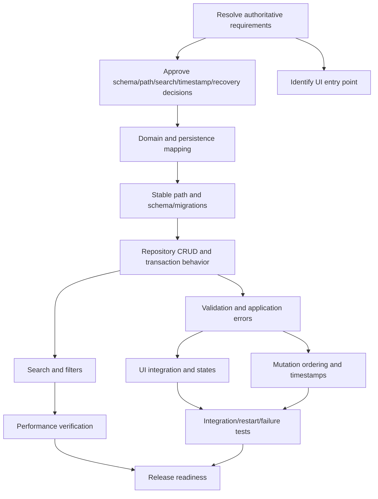

# Todo App — Prioritized Implementation Plan

## Purpose

This plan decomposes the local, single-user SQLite todo architecture in `architecture.md` and the findings in `design-review.md` into prioritized tasks with explicit dependencies and blockers. The order is dependency-first: resolve product/schema prerequisites, establish safe persistence, then build service and UI behavior, followed by search, failure testing, and performance verification.

## Status key

- **READY** — can begin when listed dependencies are complete.
- **BLOCKED** — requires an explicit prerequisite or owner decision before implementation.
- **VERIFY** — validate through tests or measurement before calling complete.

## Critical prerequisite and blockers

### P-0 — Reconcile the requirements source (**BLOCKED — must resolve first**)

The current `docs/requirements.md` in the repository describes automated documentation synchronization, while `architecture.md` and `design-review.md` describe a todo application. These are inconsistent sources of truth. Before implementation, the product owner must either:

1. Correct/replace `docs/requirements.md` with the approved todo requirements, or
2. Identify the authoritative todo requirements document and update architecture/design-review links to point to it.

**Exit criteria:** One approved, version-controlled requirements source clearly defines the todo MVP. Do not treat the documentation-sync requirements as the todo product specification.

### P-1 — Confirm architecture recommendations (**BLOCKED for affected tasks**)

The design review records the following as recommendations pending owner confirmation, not approved decisions:

- Preserve the existing `tasks` table and map `pending`/`done` to a domain completion boolean; retain extra fields.
- Use a stable OS-appropriate application-data directory.
- Define Unicode case-insensitive search semantics and use Python `casefold()` initially.
- Choose UTC timestamp representation and guarantee `updated_at` advances on every successful modification.
- Define backup/recovery guidance for corruption or I/O failure.

**Exit criteria:** Owner records decisions for these items. Schema, storage path, search, timestamps, and recovery tasks below are blocked until their relevant choices are confirmed.

### P-2 — Identify presentation entry point (**BLOCKED for UI integration**)

The architecture intentionally leaves the UI framework/entry point open.

**Exit criteria:** Identify the app entry point and confirm whether implementation targets the existing CLI/UI or a new presentation adapter. Backend/service work can proceed after P-0; UI integration cannot.

## Prioritized dependency-ordered tasks

### Phase 0 — Product and design decisions

#### T-001 — Establish the authoritative todo requirements
- **Priority:** P0 / Critical
- **Status:** BLOCKED by P-0
- **Dependencies:** None
- **Work:** Resolve the conflicting requirements document and approve the todo MVP scope, data fields, validation, search/filter semantics, error behavior, and performance target.
- **Done when:** There is one approved requirements source; architecture/design-review links are accurate.

#### T-002 — Approve data-model compatibility and migration direction
- **Priority:** P0 / Critical
- **Status:** BLOCKED by T-001 and P-1
- **Dependencies:** T-001
- **Work:** Choose whether to retain `tasks.status` and map `pending`/`done`, or migrate to a persisted `completed` field. Decide whether description, priority, and due-date columns remain supported. Define behavior for existing database files.
- **Done when:** A written decision identifies the authoritative persisted completion representation, migration requirements, and preservation rules.

#### T-003 — Approve database location and recovery policy
- **Priority:** P0 / Critical
- **Status:** BLOCKED by T-001 and P-1
- **Dependencies:** T-001
- **Work:** Confirm stable application-data directory, configuration override, backup guidance, and user-facing behavior for corruption/read-only/disk-full errors. Confirm that an unreadable database must not be overwritten or silently recreated.
- **Done when:** Runtime path and recovery behavior are documented.

#### T-004 — Approve search and timestamp semantics
- **Priority:** P1 / High
- **Status:** BLOCKED by T-001 and P-1
- **Dependencies:** T-001
- **Work:** Confirm locale-independent Unicode case-insensitive contains search and select a UTC timestamp representation/strict advancement strategy for `updated_at`.
- **Done when:** Search behavior and timestamp guarantees are testable and unambiguous.

#### T-005 — Identify presentation interface
- **Priority:** P1 / High
- **Status:** BLOCKED by P-2
- **Dependencies:** T-001
- **Work:** Identify existing app entry point and decide which UI/CLI adapter will call application services.
- **Done when:** UI integration target and interaction pattern are documented. Do not introduce a new UI framework without approval.

### Phase 1 — Persistence foundation

#### T-010 — Define domain model and persistence mapping
- **Priority:** P0 / Critical
- **Status:** BLOCKED pending T-002
- **Dependencies:** T-002
- **Work:** Define the Python todo/domain representation and mapping to the selected existing or migrated SQLite schema. Keep one source of truth for completion.
- **Done when:** Model and mapping tests cover IDs, title, completion, and timestamps, including legacy status mapping if retained.

#### T-011 — Implement stable database path and connection configuration
- **Priority:** P0 / Critical
- **Status:** BLOCKED pending T-003
- **Dependencies:** T-003
- **Work:** Update `src/database.py` to use the approved stable app-data path, support an explicit test/development override, create parent directories safely, set a bounded SQLite busy timeout, and surface permission/open errors.
- **Done when:** Tests prove path stability independent of current working directory, configuration override works, and open/permission failures become typed storage errors.

#### T-012 — Add schema versioning and safe initialization/migrations
- **Priority:** P0 / Critical
- **Status:** BLOCKED pending T-002; depends on T-010 and T-011
- **Dependencies:** T-010, T-011
- **Work:** Implement schema version tracking (`PRAGMA user_version` or equivalent); make initialization idempotent; add only the migration selected in T-002; ensure migration failures roll back and do not replace the original database.
- **Done when:** Fresh database setup, current-schema open, upgrade path, and migration failure are covered by tests. Existing records, IDs, and timestamps survive the approved migration.

#### T-013 — Define transactions, storage error types, and rollback behavior
- **Priority:** P0 / Critical
- **Status:** READY after T-011
- **Dependencies:** T-011
- **Work:** Define storage exception categories (unavailable, busy/locked, integrity, migration/corruption, I/O/permission); use explicit transaction boundaries for mutations; guarantee rollback on failure; avoid unbounded retries.
- **Done when:** Unit tests simulate failed writes and locked/read-only scenarios; no failed operation is reported as successful and committed data remains intact.

### Phase 2 — Repository and application behavior

#### T-020 — Implement/align repository CRUD by stable ID
- **Priority:** P0 / Critical
- **Status:** READY after persistence foundation
- **Dependencies:** T-010, T-012, T-013
- **Work:** Adapt `src/repository.py` for create/get/list, field-specific title/completion updates, and permanent delete by ID. Bind all values as parameters. Return persisted records after commit.
- **Done when:** Repository tests cover stable IDs, no reindexing dependency, timestamps, atomic operations, not-found results, and rollback on failure.

#### T-021 — Implement service validation and error translation
- **Priority:** P0 / Critical
- **Status:** READY after T-020
- **Dependencies:** T-020
- **Work:** Adapt `src/service.py` for title trimming, blank/whitespace rejection, 1–255 character validation, supported status mapping, not-found behavior, and safe application-level error mapping.
- **Done when:** Service tests verify boundary lengths, whitespace (including Unicode whitespace), invalid input, not-found, and storage failure behavior.

#### T-022 — Guarantee timestamp behavior
- **Priority:** P1 / High
- **Status:** BLOCKED pending T-004; depends on T-020
- **Dependencies:** T-004, T-020
- **Work:** Implement consistent UTC timestamps and ensure `updated_at` strictly advances on every committed title or completion update, including rapid successive updates. Preserve `created_at`.
- **Done when:** Deterministic tests cover create, edit, toggle, rapid repeated mutations, and immutable `created_at`.

#### T-023 — Serialize rapid same-record mutations
- **Priority:** P1 / High
- **Status:** READY after T-020
- **Dependencies:** T-020, T-021
- **Work:** Add per-ID serialization or an equivalent ordered command mechanism at the service boundary. Use field-specific updates to prevent stale full-record overwrites. Define ordering as service acceptance order.
- **Done when:** Concurrent/rapid toggle-then-edit and edit-then-toggle tests prove both intended field values survive and final persisted state follows accepted order.

### Phase 3 — Search and filtering

#### T-030 — Implement search/filter use case with approved semantics
- **Priority:** P1 / High
- **Status:** BLOCKED pending T-004; depends on T-020 and T-021
- **Dependencies:** T-004, T-020, T-021
- **Work:** Implement case-insensitive title contains search and All/Active/Completed filters with AND behavior. Use Python `casefold()` or the approved alternative; do not rely on SQLite default `LIKE` for general Unicode case-insensitivity.
- **Done when:** Tests cover ASCII and non-ASCII case pairs, substring matching, combined filters, query clearing, no matches, and that search/filter do not write data.

#### T-031 — Validate search performance approach
- **Priority:** P1 / High
- **Status:** VERIFY after T-030
- **Dependencies:** T-030, T-040
- **Work:** Benchmark list load and live search using a representative dataset of a few thousand todos on the target runtime. Add UI debounce only if it improves responsiveness without violating expected live-search behavior. Reassess Python-side filtering versus SQLite/FTS based on results.
- **Done when:** Results and environment are recorded; list-load target is approximately 1–2 seconds, and chosen search behavior is responsive. Any target miss has an agreed remediation.

### Phase 4 — Presentation and user-visible states

#### T-040 — Integrate presentation adapter with application services
- **Priority:** P1 / High
- **Status:** BLOCKED by T-005; depends on T-021
- **Dependencies:** T-005, T-021
- **Work:** Wire startup load and create/edit/toggle/delete actions to the service; pass IDs; display only persisted success state; avoid direct SQL from UI.
- **Done when:** End-to-end flows work through the selected existing UI/CLI without bypassing service/repository boundaries.

#### T-041 — Implement validation, empty, loading, and storage error states
- **Priority:** P1 / High
- **Status:** BLOCKED by T-005; depends on T-040
- **Dependencies:** T-005, T-040, T-013
- **Work:** Present inline title errors; distinguish loading, loaded-empty, no-results, and data-unavailable states; show safe actionable errors for failed writes and preserve last committed state.
- **Done when:** Manual and automated UI-facing tests verify each state and the app remains usable after failures.

#### T-042 — Implement delete confirmation and filtered-list reconciliation
- **Priority:** P1 / High
- **Status:** BLOCKED by T-005; depends on T-040
- **Dependencies:** T-005, T-040, T-020
- **Work:** Confirm permanent deletion before invoking the service; on failure keep the item visible; after success refresh the visible query/filter result correctly.
- **Done when:** Cancel, successful delete, failed delete, and deletion of the last matching result all behave as required.

### Phase 5 — Quality, recovery validation, and release readiness

#### T-050 — Build integration/restart/failure test coverage
- **Priority:** P0 / Critical
- **Status:** READY as foundational tests; complete after T-012 through T-042
- **Dependencies:** T-012, T-020, T-021, T-030, T-040, T-041, T-042
- **Work:** Add end-to-end tests for create/restart, edit/restart, toggle/restart, delete/restart, invalid input, failed read/write, migration, corruption fail-closed behavior, and rapid sequential updates.
- **Done when:** Tests use temporary isolated databases, protect real data, and cover the requirements' manual QA cases.

#### T-051 — Add recovery and operational guidance
- **Priority:** P2 / Medium
- **Status:** BLOCKED pending T-003
- **Dependencies:** T-003, T-041
- **Work:** Document where the database is stored, how to back it up, what users should do after corruption/read-only/disk-full errors, and what the app intentionally will not do automatically.
- **Done when:** User-facing and developer recovery guidance matches the approved policy and does not imply automatic recovery where none exists.

#### T-052 — Run regression and performance gates
- **Priority:** P0 / Critical
- **Status:** VERIFY after implementation
- **Dependencies:** T-050, T-031, T-051
- **Work:** Run the full pytest suite, regression checks for any existing task fields/features retained, and recorded load/search benchmarks. Verify no UI path bypasses service/repository layers.
- **Done when:** All required tests pass, benchmark results meet or have an approved exception to the target, and unresolved blockers are explicitly accepted before release.

## Dependency overview

## Explicit blocked work

The following work must not be started or merged as final behavior until prerequisites are resolved:

- **All product implementation:** blocked until the todo requirements source is reconciled (P-0/T-001).
- **Schema changes and migration:** blocked until the owner selects the existing-schema mapping or migration path (P-1/T-002).
- **Production DB path and recovery UX:** blocked until path/backup/recovery policy is approved (P-1/T-003).
- **Search behavior and query strategy:** blocked until Unicode semantics are approved (P-1/T-004).
- **Timestamp implementation:** blocked until UTC representation and monotonic update strategy are approved (P-1/T-004).
- **UI integration:** blocked until the presentation entry point is identified (P-2/T-005).
- **Release:** blocked until integration/failure tests pass and performance is measured (T-052).

Backend work that does not encode these unresolved choices may proceed only as isolated tests/prototypes; it must not be treated as the final product decision.

## Definition of MVP complete

The MVP is ready when the authoritative todo requirements and owner decisions are recorded; todos persist in the approved SQLite schema across restart; CRUD uses stable IDs; validation, timestamps, search/filter semantics, and failure states meet requirements; database errors cannot silently appear successful or overwrite data; the UI is integrated through the service layer; and required automated/manual QA plus performance checks pass.
